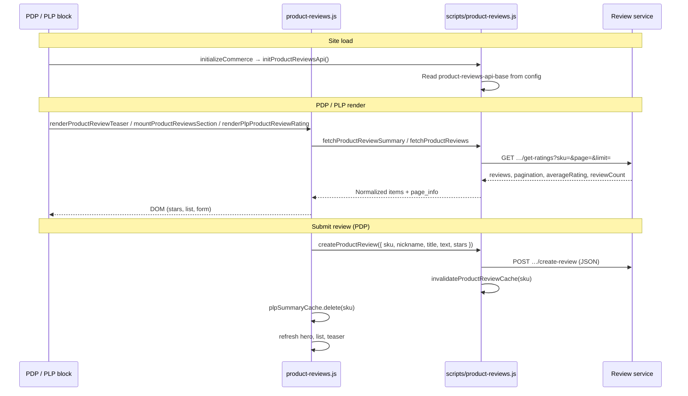

# Product reviews on the storefront

**Title for shared documentation:** Custom product reviews on PDP and PLP (Mesh REST / App Builder)

**Repo:** https://github.com/bv-prakash/storefrontaccs/

---

## At a glance (for slides or one-pager)

| Topic | Summary |
| --- | --- |
| **What** | Star ratings + review count on PLP/PDP; full reviews, write form, and pagination on PDP **Reviews** tab |
| **Data source** | External review service (Adobe I/O Runtime), **not** Commerce storefront GraphQL |
| **Config** | `product-reviews-api-base` per store view in site config |
| **PDP** | Teaser under price; Reviews tab with overview, form (name, title, stars, text), list (5 per page) |
| **PLP** | Stars + “N Reviews” under title **only when** count &gt; 0 |
| **Authors** | No new CMS block — uses existing **Product Details** and **Product List Page** |

---

## Purpose

Shoppers see **star ratings** and **review counts** on the product list and product detail pages, read customer reviews on the **Reviews** tab, and can **submit a new review** (name, title, star rating, and review text). Reviews are served by a **dedicated review service** (Adobe I/O Runtime / App Builder), not by standard Commerce storefront GraphQL. The storefront reads one **review service base URL** per store view from site configuration.

---

## What we implemented

### Product detail page (PDP)

| Area | Behavior |
| --- | --- |
| **Under price** | If reviews exist: gold star icons + underlined **“N Reviews”** (no numeric average such as “3.5” in the teaser). Click scrolls to the Reviews tab. If none: **Be the first reviewer** opens the Reviews tab and the write form. |
| **Reviews tab — overview** | Overall stars and review count, star-by-star breakdown bars, and **Write a Review** (opens/closes the form). |
| **Reviews tab — form** | Placed **above** the review list. Collapsed by default. Fields: star rating (hover preview, click to select), your name, **review title**, review text, submit. **Write a Review** and **Be the first reviewer** toggle the same form. Leaving the Reviews tab closes the form. |
| **Reviews tab — list** | Each review shows author, stars, title, text, and date when available. **Five reviews per page**; Previous / Next when there are more than five. |
| **Configurable products** | Reviews reload when the active product SKU changes (`pdp/data` event → `syncProductReviews`). |

### Product list page (PLP)

| Area | Behavior |
| --- | --- |
| **Product card** | Stars + **“N Reviews”** under the product title **only if** that SKU has at least one review. Rating mount is a **sibling** of the title link (not inside it) so line-clamp on the title does not clip stars. |

### Visual design

- Inline SVG stars (Lucide-style path): **filled gold** for rated stars, **outline** for empty, **half star** for fractional averages (e.g. 3.5).
- Styles scoped under `.product-details` and `.product-list-page` in `product-reviews.css`.
- Reference icon asset: `icons/star.svg` (stars in UI are built in JS, not loaded from this file at runtime).

---

## How it is implemented

### Runtime flow

### Layer responsibilities

| Layer | Role |
| --- | --- |
| **Site config** | Supplies `product-reviews-api-base` for each store/locale. |
| **`scripts/product-reviews.js`** | REST client: init, GET ratings (cached per sku/page/limit), POST create review, rating normalization (1–5 or legacy 0–100), summary helpers. |
| **`scripts/commerce.js`** | Calls `initProductReviewsApi()` during `initializeCommerce()` before drop-ins load. |
| **`scripts/components/product-reviews/product-reviews.js`** | All DOM: stars, teaser, hero/breakdown, form, list, pagination, PLP row; tab/form UX; in-memory **PLP summary cache**. |
| **`scripts/components/product-reviews/product-reviews.css`** | Presentation for PDP and PLP review UI. |
| **`blocks/product-details/product-details.js`** | Markup hooks (`.product-details__review-teaser`, `.product-details__reviews`), loads CSS, `reviewLabels` from placeholders, `syncProductReviews(sku)` on product data. |
| **`blocks/product-list-page/product-list-page.js`** | `SearchResults` slot `ProductName`: `appendSibling` + `renderPlpProductReviewRating`; loads CSS. |

### Configuration

| Key | Location | Purpose |
| --- | --- | --- |
| `product-reviews-api-base` | `config.json` → `public` per store | Live/stage base URL (no trailing slash required). |
| `product-reviews-api-base` | `default-site.json` | Provisioning placeholder `{PRODUCT_REVIEWS_API_BASE}`. |

Example shape (values vary by environment):

- Base: `https://…/api/v1/web/product-reviews`
- **GET** `{base}/get-ratings?sku={sku}&page={n}&limit={n}`
- **POST** `{base}/create-review` with JSON body `{ sku, author, title, review, rating }`

Request headers reuse Commerce Mesh headers via `getHeaders('all')` and `getHeaders('cs')` from drop-in config.

### REST client (`scripts/product-reviews.js`)

| Export | Use |
| --- | --- |
| `initProductReviewsApi()` | Reads config; logs warning if missing. |
| `averageRatingToStars(value)` | Maps API rating to 0–5 display scale. |
| `summarizeReviewItems(items, apiAverage, totalCount)` | Count + average stars for teasers/hero. |
| `fetchProductReviews(sku, { pageSize, currentPage, force })` | Paginated list + `averageRating` / `reviewCount`; in-memory cache key `sku::pageSize::currentPage`. |
| `fetchProductReviewSummary(sku)` | Lightweight summary for teaser/PLP (uses first page fetch). |
| `createProductReview({ sku, nickname, text, title, stars })` | POST review; clears cache for SKU. |
| `invalidateProductReviewCache(sku)` | Clears all cached pages for a SKU. |

Response mapping normalizes Mesh fields (`author`, `title`, `review`, `rating`) to internal shape (`nickname`, `summary`, `text`, `average_rating`, `created_at`).

### UI module (`scripts/components/product-reviews/product-reviews.js`)

| Export | Use |
| --- | --- |
| `renderProductReviewTeaser(container, sku, { labels, formId })` | PDP under-price row. |
| `mountProductReviewsSection(container, sku, { labels })` | Full Reviews tab panel (`id="product-reviews"`). |
| `renderPlpProductReviewRating(container, sku)` | PLP card; removes container if no reviews. |
| `activateProductReviewsTab()` | Programmatically selects Reviews tab (teaser / first-reviewer CTAs). |

Constants:

- `REVIEWS_LIST_PAGE_SIZE = 5` — list pagination on PDP.
- `REVIEWS_BREAKDOWN_FETCH_LIMIT = 100` — max reviews loaded to compute star breakdown bars.
- `plpSummaryCache` — per-SKU PLP summary; cleared on successful submit for that SKU.

Form submit sends `title` from the dedicated field; star input uses stable DOM updates (`applyStarSvgFill`) so hover/click stay in sync.

### Product Details integration

- Template includes `.product-details__review-teaser` and `.product-details__reviews` inside the Reviews tab panel.
- `reviewLabels` map **Global** placeholders (see table below) with English fallbacks.
- `syncProductReviews` skips duplicate SKU; called from `events.on('pdp/data', …)`.

### Product List Page integration

- In `SearchResults` slot `ProductName`, creates a `div` and calls `ctx.appendSibling(ratingMount)` so ratings are not inside the line-clamped title anchor.

### CMS / placeholder labels (PDP)

Add or translate under **Global** placeholders as needed:

| Placeholder key | Default (fallback) |
| --- | --- |
| `BeFirstReviewer` | Be the first reviewer |
| `ViewReviews` | View reviews |
| `CustomerReviews` | Review |
| `ReviewsListHeading` | Reviews |
| `WriteReview` | Write a review / Write a Review (CTA) |
| `ReviewAuthor` | Your name |
| `ReviewTitle` | Review title |
| `ReviewText` | Your review |
| `SubmitReview` | Submit review |
| `ReviewRatingRequired` | Please select a star rating. |
| `ReviewFieldsRequired` | Please fill in all fields. |
| `ReviewSubmitted` | Thank you. Your review was submitted for approval. |
| `ReviewSubmitError` | Could not submit your review. |
| `NoReviewsYet` | No reviews yet. |
| `ReviewsUnavailable` | Reviews are unavailable right now. |
| `ReviewsPrevious` | Previous |
| `ReviewsNext` | Next |
| `ReviewsPageOf` | Page {current} of {total} |
| `ReviewsPagination` | Reviews pagination |

---

## Files added and modified

Use this list when enhancing, debugging, or removing the feature.

### Added

| Path | Description |
| --- | --- |
| `scripts/product-reviews.js` | Mesh REST client, cache, create/read helpers. |
| `scripts/components/product-reviews/product-reviews.js` | Review UI component (PDP + PLP). |
| `scripts/components/product-reviews/product-reviews.css` | Scoped styles for review UI. |
| `scripts/components/product-reviews/README.md` | This document. |
| `icons/star.svg` | Reference star icon (optional asset). |

### Modified

| Path | What changed |
| --- | --- |
| `scripts/commerce.js` | Dynamic import + `initProductReviewsApi()` in `initializeCommerce()`. |
| `config.json` | `product-reviews-api-base` for configured store views. |
| `default-site.json` | `{PRODUCT_REVIEWS_API_BASE}` placeholder for new environments. |
| `blocks/product-details/product-details.js` | Imports, teaser/reviews DOM, CSS load, `reviewLabels`, `syncProductReviews`, Reviews tab markup. |
| `blocks/product-list-page/product-list-page.js` | Import, CSS load, `ProductName` slot + `renderPlpProductReviewRating`. |

No dedicated AEM **block** folder was added; reviews are a **script component** wired into existing commerce blocks.

---

## How to implement (checklist)

1. Deploy and CORS-enable the review service for localhost, `*.aem.page`, and `*.aem.live`.
2. Set `product-reviews-api-base` in `config.json` (and provisioning env for `default-site.json`).
3. Confirm `initializeCommerce()` still calls `initProductReviewsApi()` (see `scripts/commerce.js`).
4. Confirm **Product Details** loads review CSS and calls `syncProductReviews` on `pdp/data`.
5. Confirm **Product List Page** uses `appendSibling` for the rating mount.
6. Add Global placeholders for review copy if you need authored translations.
7. Run `npm run lint` before merge; smoke-test PDP (teaser, tab, form, pagination, variant SKU) and PLP (stars only when count &gt; 0).

---

## Future enhancements (where to change code)

| Goal | Suggested touchpoints |
| --- | --- |
| Change page size or breakdown depth | `REVIEWS_LIST_PAGE_SIZE`, `REVIEWS_BREAKDOWN_FETCH_LIMIT` in `product-reviews.js` (component). |
| Show numeric average in teaser | `createReviewRatingSummary()` — currently omits average by design. |
| Moderation / approved-only list | Filter in `normalizeMeshReview` or in Mesh API; may need new query params on `get-ratings`. |
| Rich media, verified buyer, sorting | Extend Mesh contract + list rendering in `mountProductReviewsSection` / `createReviewListItem`. |
| PLP performance (batch ratings) | Replace per-SKU `fetchProductReviewSummary` with a bulk Mesh endpoint; update `renderPlpProductReviewRating` and cache strategy. |
| Another page (cart, wishlist) | Import `renderPlpProductReviewRating` or teaser helper; load `product-reviews.css`; pass SKU. |
| Different star styling | CSS variables in `product-reviews.css` (`--product-reviews-star-filled`, sizes `--xs` … `--lg`). |
| i18n for “N Reviews” | `formatReviewsLabel()` in component or move to placeholders. |
| Backend swap | Keep UI exports stable; reimplement `scripts/product-reviews.js` against the new API. |

After API or UX changes, clear expectations: client cache is in-memory only (full reload clears it); submit already calls `invalidateProductReviewCache` and `plpSummaryCache.delete(sku)`.

---

## How to remove the feature

### A. Turn off review UI only (keep config/client for later)

1. **`blocks/product-details/product-details.js`** — Remove imports from `product-reviews.js`; remove `.product-details__review-teaser` and `.product-details__reviews` usage, `reviewLabels`, `syncProductReviews`, and `loadCSS` for product-reviews; remove Reviews tab markup if the tab should disappear entirely.
2. **`blocks/product-list-page/product-list-page.js`** — Remove import, CSS load, and `ProductName` slot logic for `renderPlpProductReviewRating`.
3. Delete folder `scripts/components/product-reviews/` (JS, CSS, README).
4. Optionally delete `icons/star.svg` if unused elsewhere.

### B. Remove completely (no network calls)

Do **A**, then:

1. **`scripts/commerce.js`** — Remove `initProductReviewsApi` import and call.
2. Delete **`scripts/product-reviews.js`**.
3. **`config.json`** / **`default-site.json`** — Remove `product-reviews-api-base`.
4. Verify in browser devtools that no requests hit `/get-ratings` or `/create-review`.
5. Run `npm run lint`.

---

## Support checklist

| Symptom | What to check |
| --- | --- |
| No stars on PDP or PLP | `product-reviews-api-base` for active store/locale; service up; console warning on missing config |
| PLP missing stars but PDP works | PLP slot uses `appendSibling`; SKU has `reviewCount &gt; 0` |
| CORS / blocked fetch | Review service allowlist for site origin |
| Submit fails | Required fields + star selected; Mesh `create-review` response / `success` flag |
| Wrong star display | Ratings 1–5 on Mesh; legacy 0–100 still supported via `averageRatingToStars` |
| Count stale after submit | Successful submit should refresh; hard reload if testing cached PLP card |
| Configurable wrong SKU | `syncProductReviews` on `pdp/data` when variant changes |
| No pagination | More than five reviews; `page_info.total_pages` from API |
| Breakdown bars empty | Enough reviews returned within `REVIEWS_BREAKDOWN_FETCH_LIMIT` fetch |

---

## Document scope

- **Short summary:** use **At a glance** for decks or stakeholder docs.
- **This README:** developer reference for behavior, file map, config, API wiring, enhancement points, and removal steps.
